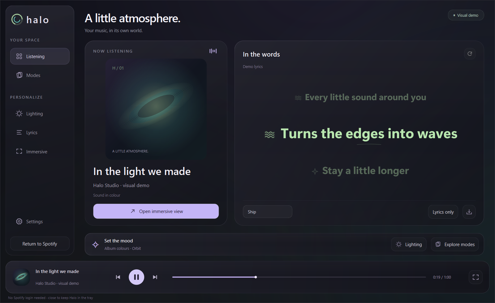
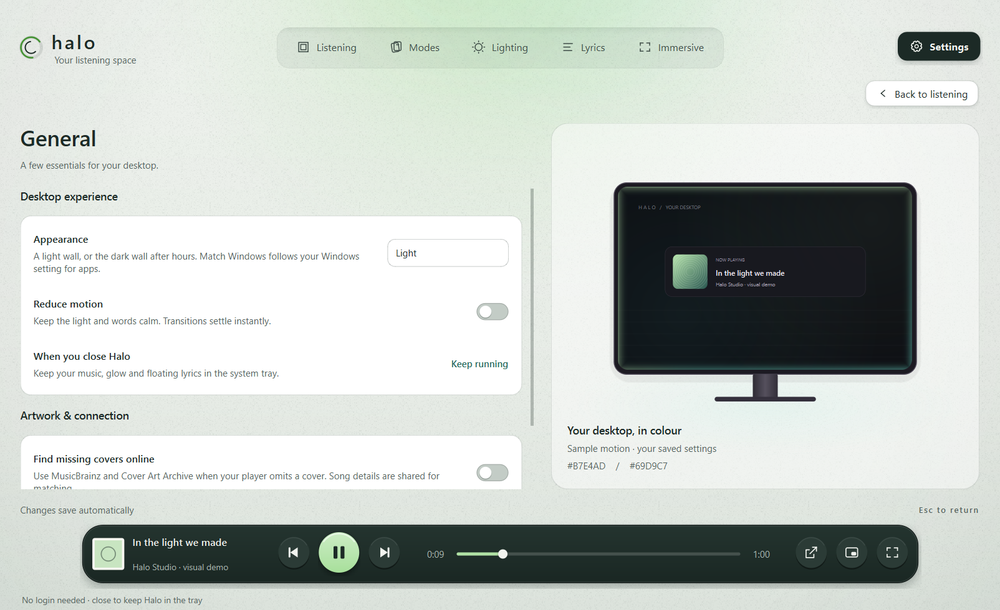

# Halo

A Windows companion for the **Spotify desktop app**, inspired by ambient music lighting and desktop lyrics. Independent software; not affiliated with Spotify, Lumn or Verci.

> **Version:** this guide describes **Halo 0.4.0**, the single-window dark-glass redesign. Earlier releases (v0.3.0 and before) look different: Settings opened in its own window from a gear at the top-right (with General, Halo, Lyrics and Immersive sections), and Modes opened from the top bar.

## Download for Windows

### [Download Halo for Windows (.zip)](https://github.com/lmaoitsatharv/halo/releases/latest/download/Halo-Windows-x64.zip)

Windows 10 (1809+) or Windows 11 · 64-bit · Portable · No Python or GitHub account needed

1. Click **Download Halo for Windows** above and save **Halo-Windows-x64.zip**.
2. Right-click the downloaded ZIP → **Extract All…** → **Extract**.
3. Open the extracted **Halo** folder and double-click **Halo.exe** (Windows may show it as **Halo**, type **Application**).
4. Play a song in the **Spotify desktop app**. Choose **Settings** in the sidebar to customize Halo.

Keep **Halo.exe**, **_internal** and **licenses** together in the extracted folder. Run the app from that folder, after extraction. No installation is needed. To quit completely, right-click the Halo icon in the system tray → **Quit Halo**.

**Updating?** Quit Halo from its tray icon, extract the new ZIP into a fresh folder, then open the new **Halo.exe**. Your saved preferences are kept separately in Windows.

[Website](https://halo-music-companion.vercel.app) · [All releases and checksums](https://github.com/lmaoitsatharv/halo/releases) · [Troubleshooting](#troubleshooting)



## What's new in 0.4.0

- **A new dark glass workspace:** a persistent sidebar, spacious listening view, smooth hover effects and a player that remains available across pages. The window keeps the standard Windows title bar and controls.
- **Everything in one app window:** Settings, Modes and immersive listening share the same window instead of opening separate windows. Lyric placement, lyric matching and colour pickers appear in inset sheets.
- Settings opens on **General**; **Lighting**, **Lyrics** and **Immersive** are available directly in the sidebar, with live previews.
- **A GPU lens for Fisheye:** surrounding words bend through a real lens on the graphics card in the main window, immersive view and floating lyrics, with standard drawing as the fallback.
- **Lucide symbols:** about 250 [Lucide](https://lucide.dev) line icons, matched to about 780 English words, replace the hand-drawn symbols.
- **Strata:** a new lyric style in **Modes**, a tilted wall of words that sways in 3D and swings to each new line.

Earlier highlights, already in v0.3.0 or before:

- **Modes library:** browse 21 live lyric, immersive and light previews, following the current song, and add your favourites to the mode selectors.
- Smoother audio pulses with a stronger, softer glow, plus cleaner Ship lyrics.
- Better missing-cover recovery, with an optional online cover lookup.
- Centered startup and remembered maximized state after immersive view.
- Better access to the auto-hidden Windows taskbar while the halo is active.
- Stronger recording checks, saved lyric corrections for each song, and supplied word timestamps where available.
- **Ship:** smooth whole-line lyrics with smaller surrounding lines, unframed illustrations and subtle motion.
- Custom immersive backgrounds: local images, muted looping videos, or current-song artwork, with live look and composition controls.



## Use the app

1. Open **Halo.exe** from the extracted **Halo** folder. If you built from source, it is in `dist/Halo/Halo.exe` (or `<dir>/Halo/Halo.exe` when built with `--dist-dir <dir>`).
2. Start a song in the Spotify desktop app. Halo detects it automatically; no Spotify login, API key or Premium account is required by Halo.
3. Halo's sidebar has **Listening** and **Modes** under *Your space*, **Lighting**, **Lyrics** and **Immersive** under *Personalize*, and **Settings** at the bottom. Choose **Settings** (or press **Ctrl+,**). Settings opens on **General** inside the main window; **‹ Back to listening** or **Esc** leaves it (Esc closes an open sheet first). Choose **Lighting**, **Lyrics** or **Immersive** in the same sidebar to adjust that part of Halo, with a live monitor preview on the right. Changes save automatically. The player stays available while browsing preferences or Modes. **Lighting** contains the screen-edge and audio switches, style picker, light sliders and colour controls. **Album colours** uses two colours from the track's artwork and smoothly fades between tracks. **General** includes Reduce motion and the optional **Find missing covers online** switch, which is off by default.
4. In **Lyrics** in the sidebar, turn on **Floating lyrics**, then minimize Halo or close its main window to the tray. Lyrics keep advancing above your desktop with clicks passing through them. Restoring the main window hides the floating text while you adjust settings.
   Use **Adjust…** in the Position row to choose a monitor, drag the preview, adjust horizontal/vertical position, or use the nine presets. **Preview on desktop** lets you see the actual placement while the settings are open. Position is saved automatically; **Reset position** restores bottom-center placement on the primary display.
5. **Open immersive view** on the Listening page, the full-screen button at the right of the player, or **Enter immersive view** in **Immersive** opens the selected scene inside the same window. **Lyrics only** on the Listening page opens the words-only scene directly. **Immersive** in the sidebar offers Listening room, Lyrics only, Cinema and Orbit; scene and lyric-style selectors are also available inside immersive view. All scenes fade the header and player and hide the cursor after 1.5 seconds without cursor movement. Move the mouse to reveal them. Leaving immersive view or switching to another app restores the cursor. **Lyrics only** hides artwork and credits. Press **Space** to play/pause and **Esc** to return. The progress bar also supports seeking.
6. Right-click Halo's icon in the system tray to open Halo, Settings, Modes or immersive view, toggle the screen-edge glow, or **Quit Halo** completely.

**Try the visual demo** (bottom of the sidebar) previews lighting and original timed text without Spotify. **Return to Spotify** ends the demo. The demo does not play audio.

The main window opens centered in your monitor's usable area. Maximizing Halo is remembered, including when returning from immersive view, restoring from the tray and starting the app again. Settings previews use the same native glow and lyric renderers as the app, except that Fisheye in Settings and the Modes library is drawn with the standard painter; the main window, immersive view and floating lyrics use the GPU lens when it is available. When synced lyrics are missing, clearly labelled original sample words appear without starting demo mode or changing playback. Page and settings-section changes, hover effects and switches animate gently; Reduce motion settles these transitions immediately. Preview rendering stops when settings closes.

## Motion and lyric styles

- **Aura:** calm, balanced album-colour light.
- **Orbit:** a rotating two-colour rim with a travelling comet highlight.
- **Wave:** moving colour ribbons around the screen.
- **Pulse:** breathing light in Flow; in Music sync, bass and percussion accents drive a strong inward bloom and brightness changes.
- **Prism:** a revolving spectrum based on the album palette.

The lyric-style selector controls the main preview, floating lyrics and all immersive scenes:

- **Ship:** smooth whole-line scrolling, smaller surrounding lines and fine, unframed illustrations. No word highlighting or spotlight box.
- **Fisheye:** a kinetic word stack with quieter surrounding words and tilted colour strips, bent by a GPU lens when one is available, with [Lucide](https://lucide.dev) line symbols.
- **Visual:** one large word and symbol at a time, with soft transitions.

Open **Modes** in the sidebar (or **Explore modes** on the Listening page, **Modes** in the tray menu or inside immersive view) to browse live previews of more lyric styles, immersive rooms and halo lights. **Add to my modes** saves a look to its usual selector immediately; **Use mode** adds and applies it. Search, category filters and **My modes** help keep your collection organised. The familiar modes stay included, and optional additions can be removed again.

Ten additional designs are available in the bundled gallery:

| Lyrics | Immersive rooms | Halo light |
| --- | --- | --- |
| **Monument** — an editorial verse poster | **Gallery** — framed artwork with a travelling key-light | **Aurora** — flowing light curtains |
| **Marquee** — a horizontal word ribbon | **Runway** — a perspective light corridor | **Echo** — opposing waves and expanding ripples |
| **Afterimage** — layered typographic echoes | **Refraction** — glass facets and spectral ribbons | **Meteor** — three separated comets and their trails |
| **Strata** — a tilted wall of words that sways in 3D and swings to each new line | | |

Previews follow the current song's lyrics, playback position, saved correction and artwork. Clearly labelled sample words appear when timed lyrics are unavailable. Browsing keeps your music playing; additions and choices are saved locally. Preview motion can be paused and honours Reduce motion. See the [Modes guide](docs/modes.md).

Ship follows the source's line timestamps. The word-based styles use supplied word timestamps from LRCLIB Lyricsfile data or Enhanced LRC imports when available. Otherwise, they estimate word timing between line timestamps and reanchor at each line. The lyrics badge distinguishes **Word synced**, **Mixed timing**, and **Line synced · words estimated**. Supplied timestamps can still be inaccurate. **Learn word timing from playback**, off by default, follows each word by listening to your PC's sound and saves word times for replays; the badge then shows **Line synced · words following playback** or **Word timing learned on this PC**. Learned timing is an estimate, not verified sync. Click a visible lyric to seek to that line. **Reduce motion** keeps steady typography and a calm halo, and playback pause freezes the animated flow. During a source-marked singing break, the scrolling styles focus the empty space between lyrics without waiting dots.

In **Lyrics** (sidebar) → **Timing & lyrics**, **Earlier** advances lyrics by 0.1 seconds and **Later** delays them. The slider supports a correction of up to 10 seconds either way. **Reset** clears this recording's correction. Corrections are remembered across song changes and restarts; an existing all-song calibration remains the baseline. A fixed correction cannot repair uneven timestamps.

For different or incorrect words, use **Wrong lyrics? Choose a match…** to compare matched releases, their album, duration and a short preview. Your chosen source is remembered. You can also **Import timed lyrics…** from UTF-8 `.lrc`, Enhanced LRC (`.lrc` or `.elrc`), or Lyricsfile 1.0 (`.lyricsfile.yaml`, `.yaml`, `.yml`). Saved choices and imports take priority over automatic lookup. **Use automatic lyrics again** clears the saved source while keeping its timing correction.

## Immersive backgrounds

Open **Immersive** in the sidebar, or choose **Background…** inside immersive view. Select the original **Ambient** scene, current-song **Album artwork**, a local **Image**, or a local **Video**. These choices apply inside Halo's immersive view; they do not change the Windows desktop wallpaper.

The right-hand preview uses the actual media and rendering controls. Start with **Cinematic**, **Soft focus**, **Vivid**, **Monochrome** or **Dreamy**, then adjust blur, dimming, saturation, vignette and album-colour tint. Framing controls include fill/fit, zoom and horizontal/vertical focus. Still, drift and breathe motion have an adjustable speed. The chosen scene and lyric style remain independent of the background.

Videos loop silently. Playback can follow music or continue while the immersive view is open. Hidden views stop decoding, and Reduce motion freezes moving backgrounds. Supported video formats depend on the available decoder; an unreadable or missing file falls back to the ambient scene and shows a useful status in settings. Media files stay in their original location, so keep them available after selecting them.

Album backgrounds use Spotify artwork by default. Selecting **Online** searches MusicBrainz and Cover Art Archive for the current recording, while keeping Spotify's foreground cover. Spotify artwork is used while a matching online image is unavailable. The existing **Find missing covers online** setting for the player remains separate.

The halo preserves dark, saturated and neutral colours. Black creates an unlit section instead of a grey or opaque black border. Rim thickness is independent of the soft glow's spread and opacity. Changing either colour switches to **Custom**; preset changes preserve your saved custom colours and brightness values.

**Flow** moves at a steady speed, **Music sync** swells on output-audio accents, **Idle** moves slowly and **Still** keeps the light stationary. The audio toggle and Music sync selection stay in sync. Music sync adapts to the playback volume and detects sudden bass and percussion changes, including accents in compressed music whose overall loudness stays almost constant. Pulse keeps a soft bed of light between accents and blooms inward on each hit. A rounded attack and longer fade smooth each swell; it does not estimate tempo or predict a precise beat grid. Changing speed preserves the current motion phase, and album-colour fades take about 0.9 seconds. Dark halo colours do not make lyric text unreadable because the interface uses a separate readable accent.

Lighting research used [Lumn's official overview](https://www.trylumn.xyz/). Lyric styling was guided by the Verci demo video supplied with this project. The original style labels are also documented by an [independent Windows interpretation](https://github.com/darshanseenivasakumar/theaestheticslyrics); Verci's official site was unreachable during that update. Halo uses its own native renderer, motion and layouts. Its line symbols are [Lucide](https://lucide.dev) icons, matched to words by Halo's own word list. Its current lyric selector offers Ship, Fisheye and Visual.

## What this version does

- Reads title, artist, album artwork, playing/paused status, duration and timing from Spotify's Windows media session.
- Provides previous, next, play/pause and timeline seeking controls.
- Shows animated line-synced lyrics and uses supplied word timestamps where available, with an estimated fallback.
- Searches other releases and common title spellings. Every lookup route checks title, artist, duration and explicit performance/version labels; matching albums and closer durations rank first. This conservative matching can leave some songs without lyrics.
- Looks in the lyrics catalog before using the exact-record endpoint, so an error on that endpoint cannot hide an existing timed catalog match.
- Saves a timing correction from −10000 to +10000 ms for each recording. Negative makes lyrics appear later; positive makes them appear earlier.
- Remembers imported timed lyrics and deliberately selected sources by title, artist, album and rounded duration. Repeated LRC timestamps and `[offset:...]` metadata remain supported.
- Optional **React to audio** analyses local output levels and bass/percussion changes via WASAPI loopback. Otherwise, the glow moves gently. It detects accents rather than estimating tempo or predicting beat timing.
- Saves preferences and minimizes to the tray when its main window is closed.

## Privacy and limitations

Spotify metadata and artwork are read locally through [Windows media controls](https://learn.microsoft.com/en-us/uwp/api/windows.media.control.globalsystemmediatransportcontrolssessionmanager). Lyrics requests send the current song title, artist, album and duration to [LRCLIB](https://lrclib.net/docs); no Spotify credentials are requested. Automatic results are cached in memory. Explicitly chosen or imported lyrics and song corrections are saved locally in `saved-lyrics/` beside Halo's settings, so they survive restarting. Saved records are bounded to 2 MiB each and 512 recordings.

Spotify sometimes omits its cover from Windows' media feed. Halo retries late or failed native artwork and refreshes both the cover and album colours when it arrives. If you enable **Find missing covers online**, Halo sends song-title/artist search terms to [MusicBrainz](https://musicbrainz.org/doc/MusicBrainz_API) and uses its title, artist, album and duration data to select a matching release. It requests that release's front cover from [Cover Art Archive](https://musicbrainz.org/doc/Cover_Art_Archive/API), which serves images through Internet Archive. Native Spotify artwork takes priority. Lookups run in the background and use a bounded memory cache; unmatched/offline results retain the placeholder. Editions can have different covers. No login details or audio are sent for cover lookup.

Audio-reactive mode measures **all sound on the current default output device**, including other apps. It does not use the microphone, save recordings or send audio anywhere. If the output device changes, it reconnects. Silence and incompatible devices gracefully fall back to gentle motion.

**Learn word timing from playback** is optional and off by default, in **Lyrics → Timing & lyrics**. While it is on and a song is playing, a small model running on this PC analyses **all sound on the current default output device**, including other apps, to place each lyric word. Audio stays in memory for about 30 seconds at most and is never saved or sent anywhere; only word times are stored, in a `learned-timing` folder beside your settings, for up to 512 songs. **Forget learned timing** and **Forget all** remove them. Words can move abruptly on a first listen, because Halo can't see the next word coming; replays use saved timing and glide. Songs need another listen for any lines that were not clear enough to keep. It cannot follow lyrics in scripts other than Latin, or imported lyrics. Spotify's User Guidelines restrict recording content and feeding it into machine learning models, so turn this on only if you accept that.

Lyrics coverage and accuracy depend on LRCLIB or your import. When words are wrong, choose a different matched source or import corrected timed lyrics. A constant offset helps consistently early/late lyrics; it cannot repair uneven drift. If the service is unavailable, use **Retry** after a moment. Ads, podcasts and untimed tracks may have no synced lyrics. Unless **Learn word timing from playback** is on, Halo does not analyse the vocals.

Malformed or unusually large lyric inputs are rejected before display. Imports are limited to 512 KiB, 2,000 cues, 32 timestamps per source line, 2,000 characters and 256 words per cue, and 20,000 expanded words and 250,000 expanded characters across the track (repeated timestamps count each repetition). CJK character animation uses the same word budget. HTTP lyric responses are limited to 4 MiB. Catalogue title, artist and album fields are limited to 2,000 characters before recording matching. A rejected import keeps the current lyrics.

The lyrics badge distinguishes timing quality, a lookup in progress, an untimed result, missing lyrics and an unavailable service. A single timestamp containing the entire lyric text is treated as untimed unless it has genuine internal word timestamps. Lyricsfile 1.0 is a draft: its unresolved `metadata.offset_ms` field is currently ignored. Overlapping word intervals are retained, but the current single-line focus does not show simultaneous singers separately.

This app uses an ordinary fullscreen view. It does not draw over the secure Windows lock screen or replace Windows locking. Overlays can also be hidden by games running in exclusive fullscreen.

Fisheye's lens runs on the GPU, through an offscreen OpenGL 3.3 context that PySide6 already provides. If that context cannot start, a lens pass fails or frames stay over budget, Fisheye falls back to standard drawing and **Lyrics** shows a line saying the GPU lens is off on this PC. Setting the environment variable `HALO_DISABLE_LENS=1` forces the fallback. The lens has only been tested on one PC, so other graphics hardware and drivers are untested.

On laptops with two GPUs, Windows may run the lens on the discrete GPU, and battery use hasn't been measured. To avoid that, choose **Power saving** for `Halo.exe` in Windows graphics settings, or use another lyric style and restart Halo.

The portable build is unsigned. Source is included here so the app can be reviewed and rebuilt. Target: Windows 10 version 1809 or later, Windows 11, x64. Only the current development PC has been tested so far.

## Troubleshooting

- **Downloaded “Source code (zip)” or used Code → Download ZIP?** That is the developer source. Use the **Download Halo for Windows** link at the top of this page to get the ready-to-run app.
- **Missing files or the app does not start?** Extract the entire ZIP first. Keep the `_internal` folder beside **Halo.exe**; copying only the executable will not work.
- **Windows shows a publisher or SmartScreen warning?** This build is unsigned. Check that your download came from this repository's Releases page. A SHA-256 checksum is included with each release.
- **No song appears?** Open the Spotify desktop app on Windows and start playback. Spotify Web and other music players are not currently supported.
- **No lyrics?** Some tracks have no timed lyrics. Try **Retry** or import a local `.lrc` file in **Lyrics** in the sidebar.
- **Closed the window but Halo is still running?** It stays in the system tray. Right-click its icon → **Quit Halo** to stop it completely.

## Run from source

Python 3.13 is used for this build. From this folder:

```powershell
uv --cache-dir .cache venv .venv --python 3.13
uv --cache-dir .cache pip install --python .venv\Scripts\python.exe -r requirements.txt
.venv\Scripts\python.exe main.py
```

Alternatively, create a virtual environment with Python and install `requirements.txt` with pip. All app code is in `halo/`.

Source runs keep settings/logs in `.data/` beside the source. Packaged builds use `%LOCALAPPDATA%\Halo`. `HALO_DATA_DIR` overrides that location. Logs rotate and record status and errors; Halo does not intentionally record audio samples or lyric text. Learned word timing files hold word times, a hashed recording key and the lyric source id. The source id and file dates amount to a listening history, so treat that folder as private. Developer diagnostics and explicitly requested screenshots/reports can preserve listening metadata or visible lyrics, so review those files before sharing them.

## Build and verify

```powershell
.venv\Scripts\python.exe -m unittest discover -s tests -v
.venv\Scripts\python.exe qa_check.py
.venv\Scripts\python.exe diagnostics.py
.venv\Scripts\python.exe build.py
```

`diagnostics.py` only reads the Spotify session; it does not change playback. `qa_check.py` checks UI state, overlays and worker shutdown using original demo text. The test suite covers timestamp parsing, matching, pause/resume/seek, audio levels, motion controls, rendered halo modes and lyric typography. Generated previews are in `qa/`.

Install `requirements-dev.txt` for the packaging tool (PyInstaller). `build.py` runs PyInstaller with command-line options; it does not use a `.spec` file. It uses a clean native-library search path and includes an icon, dependency notices, this guide, the `docs` folder and a portable ZIP. Run the build in a normal Windows development environment; restricted application containers cannot access the desktop media session.

By default, `build.py` writes the app folder to `dist\Halo` and the archive to `dist\Halo-Windows-x64.zip`. With `--dist-dir <dir>`, it writes `<dir>\Halo` and `<dir>\Halo-Windows-x64.zip` instead. Each build captures a consistent source snapshot and uses its own work and cache directories under `.staging`. The package contains `source-manifest.json`, which records the exact module hashes, and `VERSION.txt`, which records the version from `halo/__init__.py`.

If Halo may be running from an existing build, do not overwrite that folder. Package with `--dist-dir` pointing to a fresh, empty staging folder (for example `.venv\Scripts\python.exe build.py --dist-dir .staging\release-check`), check the new executable, quit the running Halo from its tray icon, then replace the existing app folder.

The packaged app must be distributed as **the whole `Halo` folder** (or the ZIP that contains it), including `_internal` and `licenses`. Copying just `Halo.exe` is insufficient. Keep the bundled dependency licenses with it.

## Dependencies

Qt for Python / PySide6 (LGPLv3), PyWinRT (MIT), NumPy (BSD), SoundCard (BSD), PyYAML (MIT; reads imported Lyricsfile documents), Lucide (ISC, with MIT for its Feather-derived icons; Halo's line symbols). PyInstaller is the build tool. Their bundled licenses and notices are retained in the portable distribution. This project includes no Spotify assets, credentials or copyrighted lyric fixtures.
