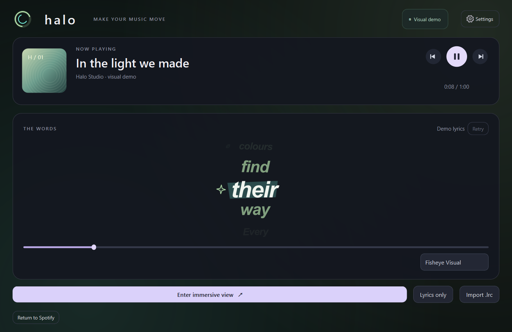
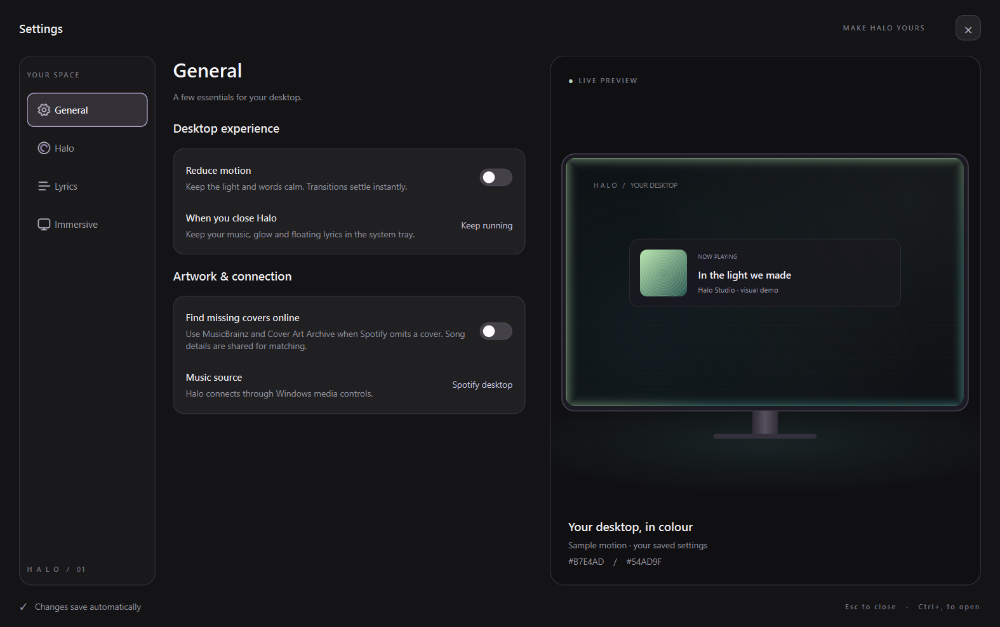

# Halo

A Windows companion for the **Spotify desktop app**, inspired by ambient music lighting and desktop lyrics. Independent software; not affiliated with Spotify, Lumn or Verci.

## Download for Windows

### [Download Halo for Windows (.zip)](https://github.com/lmaoitsatharv/halo/releases/latest/download/Halo-Windows-x64.zip)

Windows 10 (1809+) or Windows 11 · 64-bit · Portable · No Python or GitHub account needed

1. Click **Download Halo for Windows** above and save **Halo-Windows-x64.zip**.
2. Right-click the downloaded ZIP → **Extract All…** → **Extract**.
3. Open the extracted **Halo** folder and double-click **Halo.exe** (Windows may show it as **Halo**, type **Application**).
4. Play a song in the **Spotify desktop app**. Open the **Settings** gear at the top-right to customize Halo.

Keep **Halo.exe**, **_internal** and **licenses** together in the extracted folder. Run the app from that folder, after extraction. No installation is needed. To quit completely, right-click the Halo icon in the system tray → **Quit**.

**Updating?** Quit Halo from its tray icon, extract the new ZIP into a fresh folder, then open the new **Halo.exe**. Your saved preferences are kept separately in Windows.

[Website](https://halo-music-companion.vercel.app) · [All releases and checksums](https://github.com/lmaoitsatharv/halo/releases) · [Troubleshooting](#troubleshooting)



## What's new

- Settings opens on **General**, with separate **Halo**, **Lyrics** and **Immersive** sections and a live preview.
- Smoother audio pulses with a stronger, softer glow, plus cleaner Ship lyrics.
- Better missing-cover recovery, with an optional online cover lookup.
- Centered startup and remembered maximized state after immersive view.
- Better access to the auto-hidden Windows taskbar while the halo is active.



## Use the app

1. Open **Halo.exe** from the extracted **Halo** folder. If you built from source, it is in `dist/Halo/Halo.exe`.
2. Start a song in the Spotify desktop app. Halo detects it automatically; no Spotify login, API key or Premium account is required by Halo.
3. Click the **Settings** gear at the top-right (or press **Ctrl+,**). Settings opens on **General**, with **Halo**, **Lyrics** and **Immersive** in the left menu and a live monitor preview on the right. Changes save automatically. **Halo** contains the screen-edge and audio switches, style picker, light sliders and colour controls. **Album colours** uses two colours from the track's artwork and smoothly fades between tracks. **General** includes Reduce motion and the optional **Find missing covers online** switch, which is off by default.
4. In **Settings → Lyrics**, turn on **Floating lyrics**, then minimize Halo or close its main window to the tray. Lyrics keep advancing above your desktop with clicks passing through them. Restoring the main window hides the floating text while you adjust settings.
   Use **Adjust…** in the Position row to choose a monitor, drag the preview, adjust horizontal/vertical position, or use the nine presets. **Preview on desktop** lets you see the actual placement while the settings are open. Position is saved automatically; **Reset position** restores bottom-center placement on the primary display.
5. **Enter immersive view** opens the selected scene. **Settings → Immersive** offers Listening room, Lyrics only, Cinema and Orbit; scene and lyric-style selectors are also available inside immersive view. All scenes fade the header and player and hide the cursor after 1.5 seconds without cursor movement. Move the mouse to reveal them. Leaving immersive view or switching to another app restores the cursor. **Lyrics only** hides artwork and credits. Press **Space** to play/pause and **Esc** to return. The progress bar also supports seeking.
6. Right-click Halo's icon in the system tray to open it, toggle the glow or quit completely.

**Try the visual demo** previews lighting and original timed text without Spotify. **Return to Spotify** ends the demo. The demo does not play audio.

The main window opens centered in your monitor's usable area. Maximizing Halo is remembered, including when returning from immersive view, restoring from the tray and starting the app again. Settings previews use the same native glow and lyric renderers as the app; when synced lyrics are missing, clearly labelled original sample words appear without starting demo mode or changing playback. Settings section changes, the selection marker and switches animate gently; Reduce motion settles these transitions immediately. Preview rendering stops when settings closes.

## Motion and lyric styles

- **Aura:** calm, balanced album-colour light.
- **Orbit:** a rotating two-colour rim with a travelling comet highlight.
- **Wave:** moving colour ribbons around the screen.
- **Pulse:** breathing light in Flow; in Music sync, bass and percussion accents drive a strong inward bloom and brightness changes.
- **Prism:** a revolving spectrum based on the album palette.

The lyric-style selector controls the main preview, floating lyrics and all immersive scenes:

- **Ship:** clean lyrics with smooth line-by-line scrolling and steady text, without word highlighting or a spotlight box.
- **Fisheye:** a kinetic word stack whose active word swells into focus.
- **Fisheye Visual:** the word stack with tilted colour strips and original contextual symbols.
- **Visual:** one large word and symbol at a time, with soft transitions.

Ship follows LRCLIB's line timestamps. The other styles use **estimated word timing between LRCLIB's line timestamps**; it is not precise word-level synchronization. Each new line reanchors the estimates. Click a visible lyric to seek to that line. **Reduce motion** keeps steady typography and a calm halo, and playback pause freezes the animated flow.

The halo preserves dark, saturated and neutral colours. Black creates an unlit section instead of a grey or opaque black border. Rim thickness is independent of the soft glow's spread and opacity. Changing either colour switches to **Custom**; preset changes preserve your saved custom colours and brightness values.

**Flow** moves at a steady speed, **Music sync** swells on output-audio accents, **Idle** moves slowly and **Still** keeps the light stationary. The audio toggle and Music sync selection stay in sync. Music sync adapts to the playback volume and detects sudden bass and percussion changes, including accents in compressed music whose overall loudness stays almost constant. Pulse keeps a soft bed of light between accents and blooms inward on each hit. A rounded attack and longer fade smooth each swell; it does not estimate tempo or predict a precise beat grid. Changing speed preserves the current motion phase, and album-colour fades take about 0.9 seconds. Dark halo colours do not make lyric text unreadable because the interface uses a separate readable accent.

Lighting research used [Lumn's official overview](https://www.trylumn.xyz/). Lyric styling was guided by the Verci demo video supplied with this project. The four style labels are also documented by an [independent Windows interpretation](https://github.com/darshanseenivasakumar/theaestheticslyrics); Verci's official site was unreachable during this update. Halo uses its own native renderer, motion, symbols and layouts.

## What this version does

- Reads title, artist, album artwork, playing/paused status, duration and timing from Spotify's Windows media session.
- Provides previous, next, play/pause and timeline seeking controls.
- Shows animated **line-synced lyrics** from LRCLIB. This version does not claim precise word-level timing.
- Searches other releases and common title spellings when the exact album entry has only untimed lyrics. Artist and duration checks still reject unrelated recordings and covers.
- Looks in the lyrics catalog before using the exact-record endpoint, so an error on that endpoint cannot hide an existing timed catalog match.
- Offers a timing adjustment from −3000 to +3000 ms. Negative makes lyrics appear later; positive makes them appear earlier.
- Accepts UTF-8 `.lrc` files for the current song, including files with repeated timestamps and `[offset:...]` metadata. Imported lyrics reset on a song change.
- Optional **React to audio** analyses local output levels and bass/percussion changes via WASAPI loopback. Otherwise, the glow moves gently. It detects accents rather than estimating tempo or predicting beat timing.
- Saves preferences and minimizes to the tray when its main window is closed.

## Privacy and limitations

Spotify metadata and artwork are read locally through [Windows media controls](https://learn.microsoft.com/en-us/uwp/api/windows.media.control.globalsystemmediatransportcontrolssessionmanager). Lyrics requests send the current song title, artist, album and duration to [LRCLIB](https://lrclib.net/docs); no Spotify credentials are requested. Lyrics are cached in memory, not saved to disk.

Spotify sometimes omits its cover from Windows' media feed. Halo retries late or failed native artwork and refreshes both the cover and album colours when it arrives. If you enable **Find missing covers online**, Halo sends song-title/artist search terms to [MusicBrainz](https://musicbrainz.org/doc/MusicBrainz_API) and uses its title, artist, album and duration data to select a matching release. It requests that release's front cover from [Cover Art Archive](https://musicbrainz.org/doc/Cover_Art_Archive/API), which serves images through Internet Archive. Native Spotify artwork takes priority. Lookups run in the background and use a bounded memory cache; unmatched/offline results retain the placeholder. Editions can have different covers. No login details or audio are sent for cover lookup.

Audio-reactive mode measures **all sound on the current default output device**, including other apps. It does not use the microphone, save recordings or send audio anywhere. If the output device changes, it reconnects. Silence and incompatible devices gracefully fall back to gentle motion.

Lyrics coverage and accuracy depend on LRCLIB. When a track has no timed lyrics, import a local `.lrc`. If the service is unavailable, use **Retry** after a moment. Ads, podcasts and untimed tracks may have no synced lyrics.

Malformed or unusually large lyric inputs are rejected before display. Imports are limited to 512 KiB, 2,000 cues, 32 timestamps per source line, 2,000 characters and 256 words per cue, and 20,000 expanded words across the track. CJK character animation uses the same word budget. Expanded text is also bounded, and HTTP lyric responses are limited to 4 MiB. A rejected import keeps the current lyrics.

The lyrics badge distinguishes a lookup in progress from an untimed result, missing lyrics and an unavailable service. A single timestamp containing the entire lyric text is treated as untimed, rather than falsely presented as line synced.

This app uses an ordinary fullscreen view. It does not draw over the secure Windows lock screen or replace Windows locking. Overlays can also be hidden by games running in exclusive fullscreen.

The portable build is unsigned. Source is included here so the app can be reviewed and rebuilt. Target: Windows 10 version 1809 or later, Windows 11, x64. Only the current development PC has been tested so far.

## Troubleshooting

- **Downloaded “Source code (zip)” or used Code → Download ZIP?** That is the developer source. Use the **Download Halo for Windows** link at the top of this page to get the ready-to-run app.
- **Missing files or the app does not start?** Extract the entire ZIP first. Keep the `_internal` folder beside **Halo.exe**; copying only the executable will not work.
- **Windows shows a publisher warning?** This preview is unsigned. Check that your download came from this repository's Releases page. A SHA-256 checksum is included with each release.
- **No song appears?** Open the Spotify desktop app on Windows and start playback. Spotify Web and other music players are not currently supported.
- **No lyrics?** Some tracks have no timed lyrics. Try **Retry** or import a local `.lrc` file in **Settings → Lyrics**.
- **Closed the window but Halo is still running?** It stays in the system tray. Right-click its icon → **Quit** to stop it completely.

## Run from source

Python 3.13 is used for this build. From this folder:

```powershell
uv --cache-dir .cache venv .venv --python 3.13
uv --cache-dir .cache pip install --python .venv\Scripts\python.exe -r requirements.txt
.venv\Scripts\python.exe main.py
```

Alternatively, create a virtual environment with Python and install `requirements.txt` with pip. All app code is in `halo/`.

Source runs keep settings/logs in `.data/` beside the source. Packaged builds use `%LOCALAPPDATA%\Halo`. `HALO_DATA_DIR` overrides that location. Logs rotate and record status and errors; Halo does not intentionally record audio samples or lyric text. Developer diagnostics and explicitly requested screenshots/reports can preserve listening metadata or visible lyrics, so review those files before sharing them.

## Build and verify

```powershell
.venv\Scripts\python.exe -m unittest discover -s tests -v
.venv\Scripts\python.exe qa_check.py
.venv\Scripts\python.exe diagnostics.py
.venv\Scripts\python.exe build.py
```

`diagnostics.py` only reads the Spotify session; it does not change playback. `qa_check.py` checks UI state, overlays and worker shutdown using original demo text. The test suite covers timestamp parsing, matching, pause/resume/seek, audio levels, motion controls, rendered halo modes and lyric typography. Generated previews are in `qa/`.

Install `requirements-dev.txt` for the packaging tool. `build.py` uses a clean native-library search path and includes an icon, dependency notices, this guide and a portable ZIP. Run the build in a normal Windows development environment; restricted application containers cannot access the desktop media session.

Each build captures a consistent source snapshot and uses its own work and cache directories. Its `source-manifest.json` records the exact module hashes. For safe updates while Halo is running, package with `--dist-dir` pointing to a fresh staging folder, check the executable, then replace the existing app folder.

The packaged app must be distributed with **the whole `dist/Halo` folder**, including `_internal`. Copying just the executable is insufficient. Keep the bundled dependency licenses with it.

## Dependencies

Qt for Python / PySide6 (LGPLv3), PyWinRT (MIT), NumPy (BSD), SoundCard (BSD). PyInstaller is the build tool. Their bundled licenses and notices are retained in the portable distribution. This project includes no Spotify assets, credentials or copyrighted lyric fixtures.
