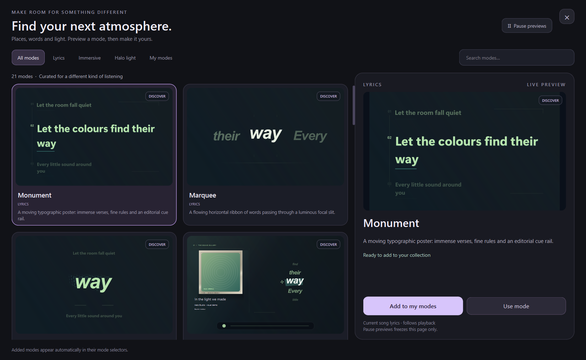

# Make room for a different kind of listening

Open **Modes** from Halo's sidebar, **Explore modes** on the Listening page, **Modes** in the tray menu, or the **Modes** button inside immersive view (which opens the immersive-room category). **Lighting**, **Lyrics** and **Immersive** also link directly to their category with **Explore light modes**, **Explore lyric styles** and **Explore immersive rooms**. Modes opens inside the main Halo window; **Back to listening** or **Esc** leaves it.

In Halo v0.3.0 and earlier, Modes opened from the top bar instead; the 0.4.0 single-window redesign moved it into the sidebar.

The gallery includes live lyric, immersive and light previews. Select a card for its larger preview. Search by name or description, browse one category, or choose **My modes** to see the looks already in your collection.

- **Add to my modes** adds a design to its ordinary mode selector immediately.
- **Use mode** adds and applies a design in one action.
- **Remove from my modes** removes an optional addition. If it was active, Halo returns to an included mode.

The curated collection is bundled with Halo and needs no account. Your choices survive restarts. The included modes remain available.

## Lyrics

**Monument** makes each verse an asymmetric editorial poster, with a numbered cue rail and ascending whole-line movement. **Marquee** sends a ribbon of words horizontally through an open focal slit. **Afterimage** gives the current word layered outline echoes, with nearby verses framing the composition. **Strata** sets the nearby words on one tilted plane that sways in 3D and swings to a new angle at each line. The current word stays bright and readable, and Reduce motion holds the plane at a fixed angle.

**Cascade** stacks words as they are sung, with the newest large and lit on a bold block, its symbol beside it, and older words climbing away. **Starline** lands each word as a star at the end of a bright thread, drawing the verse into a map that clears for the next one; a repeated chorus draws the same map. **Neon** shows the whole line as unlit glass tubes that strike on word by word in the album's colour. **Impact** throws one huge word at a time at the screen, with a shockwave in the shape of the word and a brief colour split. Under Reduce motion these four hold still: no flicker, thread animation, shockwave or shake. Cascade, Neon and Impact respond to loudness when audio reaction is on, and look complete without it. Songs without word-level timing use estimated word timing, so these word-by-word modes are less exact on them, unless **Learn word timing from playback** is on in **Lyrics → Timing & lyrics**.

The included Ship, Fisheye and Visual styles remain available. Their line symbols are Lucide icons drawn as outlines, matched to words by Halo's own English word list, with a sparkle standing in for words it does not know. Ship's symbol follows the first visual line when lyrics wrap. Source-marked singing breaks keep an empty position in the lyric flow.

## Immersive rooms

**Gallery** presents album art inside a physical matte and frame, with a grazing key-light and exhibition typography. **Runway** places panoramic lyrics inside a perspective corridor of moving light. **Refraction** combines offset artwork, translucent panes and independently drifting spectral ribbons.

These rooms work with the existing image, muted video and album-art background choices. Lyrics, room and halo-light choices stay independent.

## Halo light

**Aurora** folds broad inset curtains around the screen. **Echo** combines opposing waves with fading inner wavefronts. **Meteor** separates three bright heads with unequal fading trails and dark gaps between them. They use your current colours and light controls.

## Preview behaviour

When a song has timed lyrics, previews follow its actual lyrics, playback position and saved timing correction. Song title, artist, album and artwork also follow the current track. If no timed lyrics are available, clearly labelled sample words fill the preview until they arrive.

**Pause previews** freezes this page while your song keeps playing; resuming catches up to the song. Pausing the song holds the words and decorative motion, while seeking still updates the preview. Reduce motion keeps decorations still while live lyrics continue to update. Hidden or minimized pages stop their preview work, and only cards inside the visible scrolling area receive animation updates. Browsing never changes your song, lyric data, correction or playback position.

The selected preview updates at up to 30 times per second and cards at up to 15. Actual responsiveness depends on the computer, window size and display. These previews demonstrate the bundled renderers, except that Fisheye here uses standard drawing rather than the GPU lens that the main window, immersive view and floating lyrics use when it is available. Generated visual motion does not claim to measure the song's actual beats or singing alignment.
